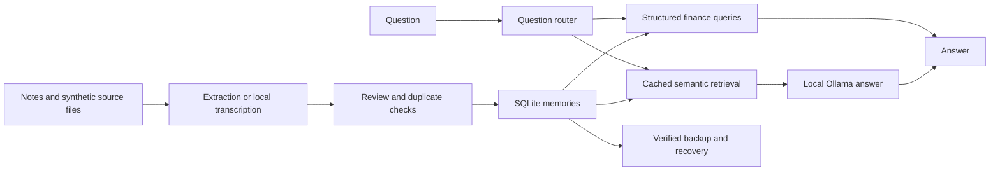

# Second Brain

A local personal-memory assistant that turns notes, documents, receipts and voice recordings into searchable memories, with human review before saving AI-extracted text or voice information.

Ask questions about saved information, track debts and repayments, and keep the original source alongside each imported memory.

## What it does

- Add, review, edit and delete text memories.
- Answer structured finance questions and use semantic retrieval for other questions.
- Track explicit due dates, partial/full repayments and repayment history, with confirmation before recording a payment.
- Extract embedded PDF text and use OCR for scanned pages, preserving page attribution.
- Read receipt images with OCR.
- Transcribe voice locally, allow manual correction, suggest structured fields, check duplicates and require explicit SAVE.
- Block exact duplicates and request review of similar memories.
- Create verified SQLite backups and restore into a new file.

## How it works



The interface uses Streamlit. SQLite stores memories and repayments. Sentence Transformers provides cached embeddings, Ollama provides local answers and field suggestions, faster-whisper provides cached transcription, and Poppler plus Tesseract handle scanned PDFs and images. PDF and image imports use the existing command-line tools; voice review is available in the dashboard.

## Local operation

The validated Windows environment uses Python 3.14.8 and the package versions recorded in `requirements-audit.txt`. This file records the tested environment; portability to other operating systems and Python versions has not been established.

Runtime prerequisites:

- A project virtual environment at `.venv` with the recorded dependencies.
- Ollama available at `http://127.0.0.1:11434`, with `qwen3:1.7b` installed.
- Cached `all-MiniLM-L6-v2` embeddings and a cached Whisper `tiny` model. Runtime loading does not download missing models.
- Tesseract and Poppler's `pdftoppm` available on PATH for OCR.
- A correctly initialized local database containing the memories and repayment schemas.

From the prepared project folder:

```powershell
.\start_local.ps1
```

Open `http://127.0.0.1:8503`. The release launcher uses a project-local virtual environment, initializes storage, binds to localhost, enables CORS and XSRF protection, disables static serving and telemetry, and limits uploads to 50 MB. See `SETUP.md` for CMD instructions and prerequisites.

An idempotent database bootstrap is included. The user completed dependency installation in a fresh virtual environment on the same Windows computer, initialized storage, passed five focused tests, opened the release dashboard, saved a synthetic note, received a sourced answer, imported a scanned PDF and loaded voice transcription. Model caches were already present; OCR used the Poppler bundled with Codex. Installation on an independent computer remains unverified.

## Validation

The 10 October 2026 acceptance run completed **168 tests: 167 passed and 1 skipped**. Coverage includes review/save safeguards, semantic duplicates, finance date boundaries, repayment confirmation and concurrency, real PDF/image OCR, voice review, dashboard edit/delete, process restart persistence and backup/recovery.

The skipped test requires Windows filesystem symlink privileges; mocked link rejection passed. OCR tests ran in a separate process to avoid a Transformers lazy-import conflict with unittest's warning registry.

Live synthetic probes confirmed a sourced answer to a known fact, abstention on an absent passport number, cached Whisper transcription, and local structured extraction. These probes do not establish accuracy across all languages or input qualities.

An empty-database Ask crash discovered during acceptance was fixed with an early empty-result return. Production database SHA-256 was unchanged throughout the milestone.

## Backup and recovery

Use a new backup filename and keep its adjacent checksum manifest:

```powershell
.\.venv\Scripts\python.exe recovery.py backup second_brain.db backups\snapshot.db
.\.venv\Scripts\python.exe recovery.py verify backups\snapshot.db
.\.venv\Scripts\python.exe recovery.py restore backups\snapshot.db backups\restored.db
```

Create the destination directory first. Restore refuses to overwrite an existing file. Database recovery does not recover external source documents; protect those separately. Keep a backup on a separate physical device.

## Limitations

Authentication and encryption are not implemented. The app is intended for local use. Public demos and screenshots must contain synthetic data only.

AI extraction and OCR require review: names can change, dates can be ambiguous, and noisy audio or faint scans can reduce accuracy. Exact duplicate protection and similarity review serve different purposes; suggested matches are not automatic proof of duplication. Ask citations identify sources but currently omit PDF page numbers. An abstaining answer can still cite an irrelevant retrieved source.

## Portfolio demo

Use an isolated code copy with a new synthetic database and synthetic source files. Follow `DEMO-WALKTHROUGH.md`. Keep production databases, backups, personal documents, recordings, model caches and local secrets out of the repository. A Git ignore file does not remove files already tracked in Git history.

Status: automated and manual acceptance complete with documented limitations; fresh virtual-environment checks passed on the original computer. This release includes the manual-test duplicate and answer-display fixes. Independent-machine setup and publication review remain. See `VALIDATION.md`.


## Demo video

[Watch or download the synthetic demo (MP4, 1:28)](https://github.com/vigilante-ilyas/second-brain/releases/download/v0.1.0/second-brain-demo-trimmed.mp4)

The recording shows sourced answers, missing-information abstention, and repayment history using synthetic data. Long waiting periods were removed while retaining the original picture quality.

[Release notes for v0.1.0](https://github.com/vigilante-ilyas/second-brain/releases/tag/v0.1.0)
